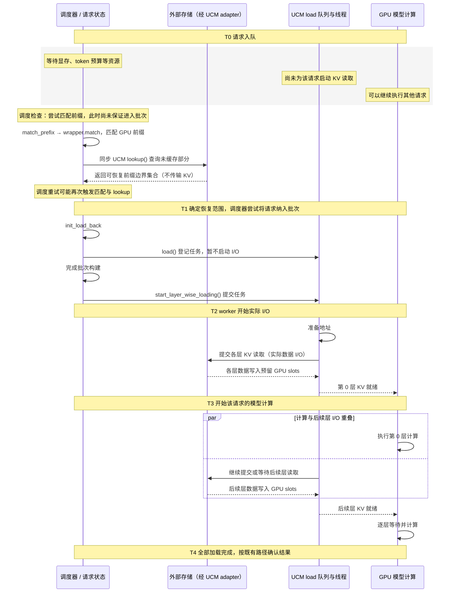
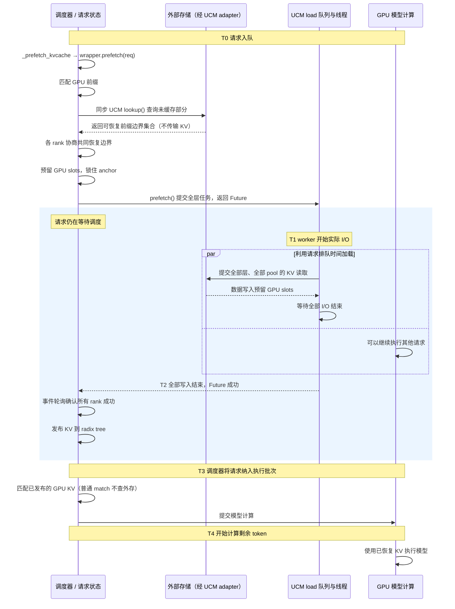

# SGLang Prefetch 接入 UCM Linker 需求说明

## 1. 背景与目标

本文描述在 `UcmDirectLinker` 中接入 SGLang Unified Cache 外部 linker prefetch 的需求与实现方案。

- UCM 源码：`C:\github项目\lc-unified\unified-cache-management`。
- SGLang 源码：`C:\github项目\sglang`。
- 分析日期：2026-11-09。
- 状态：需求与设计阶段，尚未实现或进行 GPU 运行验证。

本文以以上本地源码为基线；旧版 SGLang 的 UCM patch 不应默认具备相同接口。

### 1.1 背景与现状

UCM 已通过 `ucm/integration/sglang/ucm_direct_linker.py` 对接 SGLang 的 Unified Cache，支持从外部存储直接恢复 device KV，避免强制经过 SGLang Host cache。

当前加载链路为 `load()` 暂存请求、`start_layer_wise_loading()` 提交批次、后台 worker 按层提交加载，并通过 `layer_done_counter` 通知计算侧。计算可以在早期层加载完成后开始，与后续层 I/O 重叠。

SGLang 当前源码另外提供了请求排队阶段的 prefetch 框架：在请求进入执行批次前，异步把外部命中的全部层加载到 GPU，成功后发布到 radix tree。UCM 尚未覆盖该框架要求的 `prefetch()` 接口，因此需要增加适配。

补充说明：当前 SGLang factory 会从顶层配置解析 `load_mode`，并在构造动态 linker 后设置实例属性。因而设置 `load_mode=prefetch` 可以切换 wrapper 分支，但 UCM 继承的默认 `prefetch()` 返回 `None`，不会产生有效预取。配置开关本身不足以完成接入。

### 1.2 目标

1. 利用请求排队时间提前恢复外部 KV，减少请求进入执行批次后等待存储 I/O 的时间。
2. 复用 SGLang 已有的命中判断、显存管理、多 rank 协调、发布和回退流程。
3. 复用 UCM adapter 的地址准备、异步提交、任务检查和等待能力。
4. 保持原有 `layer_wise` 为默认模式，允许按部署场景选择。

预取收益依赖队列等待时间、命中长度、存储带宽和显存容量，不保证所有负载下优于按层加载。

### 1.3 范围与限制

- 支持当前 SGLang external linker prefetch 框架，要求 PP=1。
- 组件支持沿用 UCM 当前可恢复的 pool/layout 范围；Full、窗口状态、Mamba 的具体组合须分别验证。
- 不新增 Host 中转层，不改造 UCM 存储格式。
- 不实现异步 lookup、预测未来请求、跨请求 I/O 合并或运行中 I/O 强制终止。
- 旧版本 patch 的移植作为独立兼容工作，不承诺仅更新 UCM 即可支持。

## 2. 核心概念

### 2.1 预取类型

| 类型 | 数据流 | 与本需求关系 |
| --- | --- | --- |
| HiCache storage prefetch | 外部存储 → Host，后续再恢复到 GPU | 不是本次接入目标 |
| Unified external linker prefetch | 外部存储 → GPU | 本次接入目标 |

UCM 现有 worker 连续提交后续层的操作属于按层加载内部的 I/O 流水，不等同于请求排队阶段的 prefetch。旧配置 `sglang_load_prefetch_layers` 在当前 adapter 中仅作兼容并被移除，不应作为本功能开关。

### 2.2 队列与执行批次

这三个概念属于不同层次。“执行队列”在本文中更准确地称为执行批次，不应理解为必然存在一个独立的 FIFO 队列。

| 概念 | 保存内容 | 处理方 | 作用 |
| --- | --- | --- | --- |
| 请求等待队列 | 尚未被选入执行批次的推理请求 | SGLang 调度器 | 等待显存、token 预算等调度资源 |
| 执行批次 | 本轮选中执行 prefill 或 decode 的请求集合 | 模型执行器与 GPU | 组织本轮模型计算 |
| load 任务队列 | 将外部 KV 恢复到指定 GPU slots 的任务 | UCM 后台 load 线程 | 组织缓存数据读取，不执行模型推理 |

请求本身不会从请求队列“移动到 load 队列”；进入 load 队列的是为它生成的加载任务。启用 prefetch 时，同一个请求可以仍在等待调度，而它的加载任务已经在 load 线程中执行。

## 3. 两种加载模式与流程对比

两图均以从上到下表示时间推进，使用相同的参与方。T0～T4 表示各模式内的事件顺序，不代表两图对应事件发生在相同的绝对时间；间隔不按比例绘制。预取图展示加载在批次接纳前成功完成的情况，不表示预取一定更快。

### 3.1 未启用 prefetch：按层加载



两种模式的 lookup 都在调度侧同步执行，不进入 load 任务队列；GPU 已完整命中时无需查询外存。图中的查询表示 linker 访问存储适配层，不承诺每次都产生远端网络请求。查询命中、登记任务和实际提交 I/O 是三个不同的时点。排队期间可能进行命中查询，但实际读取在批次构建后启动加载、准备执行该批次时发生；第一层数据就绪即可计算，无需等全部层恢复。

恢复尾部先属于请求私有空间，加载未确认时不能作为共享树命中。加载失败沿用现有执行路径处理。

### 3.2 启用 prefetch：排队期间加载



请求继续留在等待队列，load 线程执行的是为其生成的加载任务。若调度器尝试接纳请求时加载尚未完成，则按第 3.4 节策略决定是否继续等待；失败或放弃的结果不会发布，运行中写入结束后才能释放 slots。

| 对比项 | 按层模式 | 预取模式 |
| --- | --- | --- |
| lookup 时机 | 调度前缀匹配时，可能因重试多次触发 | 请求入队后的预取入口 |
| KV 数据 I/O 发起阶段 | 进入执行批次/批次构建阶段 | 请求入队阶段 |
| 重叠对象 | 各层 forward | 请求排队及其他工作 |
| 首层计算 | 第一层所需数据就绪后可开始 | 预取发布要求全部层完成 |
| 共享缓存可见性 | 走请求既有插入与完成确认流程 | 全部 rank 成功后由 wrapper 提前发布 |
| 显存占用 | 主要是进入批次的恢复请求 | 额外包含排队预取和已放弃但仍在写入的 slots |
| 主要代价 | 执行阶段可能等待 I/O | 提前占用显存，可能发生无效预取 |

预取模式不是无条件更快；队列很短或显存紧张时，按层模式可能更合适。

### 3.3 预取的内部处理

1. 请求入队后，SGLang `_prefetch_kvcache()` 调用 linker wrapper 的 `prefetch(req)`。
2. 匹配现有 GPU 前缀，对未缓存部分按 page 对齐，并基于前缀 hash 生成存储 key。
3. 调用 UCM `lookup()`，取得本 rank 可完整恢复的前缀边界集合。
4. 各 attention rank 对集合求交，选择共同可恢复的最长边界。窗口状态可能只在部分边界存在，不能用各 rank 最大值的简单 MIN 替代集合求交。
5. 锁住已有前缀 anchor，为缺失部分及相关组件预留私有 GPU slots。
6. 调用 UCM `prefetch(transfers)`，获得表示整体加载结果的 Future。
7. 后台执行所有层和 pool 的加载；事件轮询确认各 rank 均成功且停止写入。
8. SGLang wrapper 发布到 radix tree，处理重复前缀与组件绑定，释放 anchor 锁。
9. 请求进入执行批次时重新匹配已发布 GPU KV，未恢复部分正常计算。

当前 lookup 是同步调用，可能阻塞调度线程；本需求的异步范围主要是数据传输阶段。

### 3.4 等待、超时与失败

| 策略 | 行为 |
| --- | --- |
| `best_effort` | 进入执行批次时消费已完成结果，否则停止等待并回退计算 |
| `wait_complete` | 保持等待，直至任务完成并被事件轮询处理 |
| `timeout` | 从首次因预取未完成而阻塞批次接纳的轮询开始计时，超时停止等待 |

当前框架超时预算由 `prefetch_timeout_base` 和按 token/page 折算的附加项构成，预算构造使用待查询 hash 数量，不能默认等同于最终命中长度。默认基数为 1 秒，每 1024 tokens 附加 0.25 秒。

停止等待后，排队任务可取消；运行中的任务必须保留私有 slots，直到所有 rank 都停止写入，再释放并丢弃结果。失败或放弃的预取不得发布，后续请求通过正常计算恢复。

## 4. 功能与正确性需求

| 编号 | 需求 |
| --- | --- |
| F1 | 默认保持 `layer_wise`，支持顶层 `load_mode=prefetch` |
| F2 | 实现 `prefetch(transfers) -> Future[bool] 或 None`，提交后立即返回 |
| F3 | 无法接收任务时返回 `None`，由 wrapper 统一回收预留资源 |
| F4 | Future 成功必须代表全部层、全部参与 pool 完整恢复，且所有 device 写入停止 |
| F5 | 任何提交或等待失败均须 drain 已提交任务，再结束 Future |
| F6 | 支持排队取消；不得把运行中任务标记为已安全回收 |
| F7 | `reset()`、`close()` 停止接收任务并排空所有 I/O 后才释放资源 |
| F8 | 保持现有 lookup 的组件边界语义、存储 key 和布局兼容性 |
| F9 | 原有按层加载及 offload 行为不回归 |

不变量：Future 进入终态之后不得继续向对应 slots 写入；不完整数据不得入树；任一 rank 失败不得仅在其他 rank 发布；取消不能改变各 rank 的 collective 参与顺序。

## 5. 实现方案

### 5.1 职责划分

| 模块 | 职责 |
| --- | --- |
| SGLang factory/config | 解析通用加载模式与策略，构造 linker |
| SGLang wrapper | 请求生命周期、lookup 协调、slots 分配、anchor 锁、跨 rank 判定、发布或丢弃 |
| UCM linker | 接收任务、记录 stream 依赖、后台调度、整体完成与失败清理 |
| UCM adapter/store | 地址准备、分层 I/O 提交、检查与等待 |

UCM 不自行向 radix tree 发布结果，也不重复实现 wrapper 的 timeout、显存回收或多 rank collective。

### 5.2 UCM linker 改造

增加明确的预取任务类型，至少包含 transfers、依赖事件和 `Future[bool]`；与现有按层批次任务共用加载队列和 worker。使用明确类型或任务标签区分两条路径，避免依赖含义不清的 tuple 位置。

`prefetch()` 建议执行：

1. 检查 worker 与关闭状态。
2. 使用现有 `_expand()` 校验并展开 transfers。
3. 复用 `_record_transfer_events()` 记录索引准备及 forward stream 依赖。
4. 创建 Future，将任务入队并返回。

worker 处理预取任务前调用 `set_running_or_notify_cancel()`；已在排队阶段取消的任务不再触碰 device slots。运行中的任务执行完成或失败 drain 后，设置整体结果。

#### 一个 prefetch 任务与所有层的关系

本方案中，一次成功接受的 `prefetch(transfers)` 调用生成一个 load 队列任务和一个整体 Future，负责本次命中范围内所有层、所有参与 pool 的恢复。“全部层”指命中 token 对应的各模型层 KV，不是加载该请求所有 token，也不是预先计算尚不存在的 KV。

```text
一个请求的本次外部命中
  → 一个 prefetch 队列任务
      → 准备各 pool 的地址与传输布局
      → 提交第 0 层 I/O 子任务
      → 提交第 1 层 I/O 子任务
      → ……
      → 检查并等待全部子任务结束
  → Future 完成
  → SGLang 确认所有 rank 成功后发布到缓存树
```

一个队列任务可以拆成多个底层 I/O 子任务，且可连续异步提交，不要求一次 I/O 读取所有层。单个 load 线程负责队列任务的处理，也不等于底层每次只能执行一个 I/O。

按本方案的单 worker 实现，当前任务未处理完时，后续任务可能仍在 load 队列等待；多个请求都提交了 Future，并不保证它们的整请求加载会并行执行。跨请求 I/O 合并与并发调度不属于首期要求。现有按层模式还可能将多个请求的恢复合并为一个批次任务，与预取模式的一次调用一个任务不同。

### 5.3 提取公共加载逻辑

将 `_load_worker()` 中准备地址、逐层提交、检查完成和 drain 的代码提取为公共函数，允许传入层完成回调：

```text
执行公共加载(transfers, ready_events, on_layer_complete)
  等待或传递 stream prerequisite
  prepare_load
  连续提交各层任务
  检查并等待各层完成
  按需调用 on_layer_complete
  异常时 drain 剩余任务
  返回整体结果
```

- 按层模式：回调更新 `layer_done_counter`，保留既有批次完成语义。
- 预取模式：无需驱动 forward 的层计数器，仅在全部完成后结束 Future。

应确认 adapter 的 `wait()` 成功代表数据完整落入 device；若底层存在短读或部分成功，必须转化为失败，不能只根据任务提交成功判定完成。

### 5.4 配置与生命周期

当前 SGLang dynamic factory 在构造 linker 后才设置 `load_mode`。因此 UCM worker 应在构造时同时具备两类任务的处理能力，不应依赖构造期间读取最终模式来选择唯一 worker。

`load_mode`、`prefetch_policy` 使用 SGLang 顶层配置；UCM 存储配置保留在 `linker_extra_config`。不在 UCM 内重复维护一套策略解析。

首期建议先使用框架默认 timeout 参数。显式设置 timeout 参数前，应处理当前 dynamic 配置严格字段校验与顶层 timeout 字段之间的兼容问题：通用解析层需消费 timeout 字段，或将其定义为允许的通用字段，不能直接将未识别字段交给 `UnifiedCacheLinkerConfig.from_dict()`。

将新增 Future 任务纳入现有 reset/close 管理，覆盖队列取消、异常和 worker 退出路径。预取占用量由 wrapper 计入 GPU 容量，UCM 不重复计数。

## 6. 使用方法（实现完成后的目标用法）

以下示例展示 Linux 推理环境的启动形式，需完成本需求后使用，并沿用现有有效的模型、设备及 UCM 配置。当前代码仅设置此配置不会获得有效预取。

```bash
python -m sglang.launch_server \
  --model-path /path/to/model \
  --enable-unified-cache-external-linker \
  --unified-cache-external-linker-backend dynamic \
  --unified-cache-external-linker-config '{
    "load_mode": "prefetch",
    "prefetch_policy": "timeout",
    "linker": "UcmDirectLinker",
    "linker_module_path": "ucm.integration.sglang.ucm_direct_linker",
    "linker_extra_config": {
      "UCM_CONFIG_FILE": "/path/to/ucm_config.yaml"
    }
  }'
```

使用前提：UCM 包在 worker 环境中可导入；配置文件可访问且存储 backend 支持对应设备地址加载；PP=1；模型 pool/layout 在双方支持范围内。其他模型必需参数沿用当前部署。

- 功能验证可选择 `wait_complete`，便于明确观察恢复是否完成。
- 允许有限等待可使用默认 `timeout`。
- 优先降低等待可选择 `best_effort`，但加载未及时完成时可能产生无效 I/O。
- 回退现有行为：将 `load_mode` 改为 `layer_wise`，或移除此字段。

验证缓存复用时，先发起请求并确认 offload 完成，再通过另一实例或清理 GPU 本地缓存后的请求触发外部恢复；保持模型、token、cache salt 和存储命名一致，避免只测到本地 GPU 命中。不要通过清空外部存储的方式验证外部命中。

## 7. 验收与验证

### 7.1 正确性验收

1. 默认模式与改造前行为一致。
2. 预取确实在进入执行批次前提交，全层成功后才可匹配到树中结果。
3. 与禁用外部缓存的结果对照，验证输出与 KV 恢复正确性。
4. 覆盖 miss、部分命中、稀疏恢复边界以及 Full/窗口/Mamba 支持组合。
5. 多 rank 中任一 rank 失败或超时，所有 rank 对发布/丢弃保持一致。
6. 覆盖排队取消、运行中取消、提交失败、等待失败、reset 和 close；确认无残留写入、显存泄漏或未完成 Future。
7. 覆盖重复前缀、同 rid 新 attempt、显存分配不足与并发 offload。
8. PP>1 明确拒绝 prefetch 配置，失败信息可定位。

测试分为可控假 adapter 的任务生命周期测试，以及真实 GPU/UCM backend 的集成测试。假 adapter 不能替代 device 写入顺序与完整性验证。

### 7.2 性能与可观测性

在相同模型、命中长度、存储状态和请求并发下，对比两种模式的 TTFT、吞吐、排队时间、GPU 峰值占用、加载耗时和无效读取量。至少区分短队列、长队列、低命中和显存压力场景。

建议日志包含预取提交/完成/失败/取消数、读取页数、排队及执行耗时；区分“停止等待”和“I/O 已停止”。首期不设未经测量的固定性能提升指标。

## 8. 主要源码参考

- `ucm/integration/sglang/ucm_direct_linker.py`：lookup、按层任务队列、worker、reset/close。
- `ucm/integration/sglang/ucm_direct_store_adapter.py`：UCM 配置、prepare/submit/check/wait 与 stream prerequisite。
- `python/sglang/srt/mem_cache/unified_cache/unified_cache_linker.py`：prefetch 接口、请求状态、跨 rank 判定和结果发布。
- `python/sglang/srt/mem_cache/unified_cache/linker_factory.py`：dynamic linker 构造与模式赋值。
- `python/sglang/srt/mem_cache/unified_cache/linker_config.py`：通用选项解析与动态配置字段校验。
- `python/sglang/srt/mem_cache/unified_radix_cache.py`：预取入口、进度检查、事件处理及 timeout 初始化。
- `python/sglang/srt/mem_cache/storage/mooncake_store/mooncake_direct_linker.py`：已有 Future 预取实现参考。
- `ucm/integration/sglang/patch/v0520/`：旧版适配参考，需单独审计接口兼容性。

