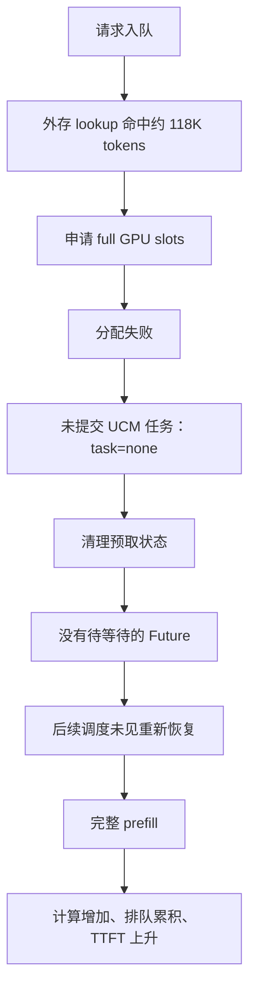

# SGLang UCM Linker Prefetch 性能分析报告

## 1. 结论

当前 `prefetch + wait_complete` 的主要性能损失，并非已证实的外存读取变慢，而是高容量压力下外存命中的请求无法分配 GPU KV slots，预取在提交 UCM worker 之前就被放弃，后续执行时重新计算完整输入。

128K / 5 的诊断日志确认：第一个请求复用 HBM 中的约 118K 前缀；后四个请求均查询到外部约 118K 前缀，但所有 TP rank 分配失败，`task=none`，结果被丢弃。后续四个请求逐个执行完整 prefill，形成长队列并显著拉高 TTFT。

64K / 2 清空 HBM 的隔离实验则确认：容量充足时，两个请求都成功完成外部查询、全层加载、跨 rank 确认、发布和计算复用。因此基础传输链路可用；容量不足时的延期、重试与执行前恢复机会是当前优先修复项。

此外，隔离实验测出单 worker 按请求处理全层加载，第二个请求排队约 748 ms。这是独立的性能优化点，但不能解释那些根本没有提交加载的请求。

## 2. 测试条件与解释边界

| 项目 | 配置 |
| --- | --- |
| 模型 | GLM-5.2-W4AFP8，量化 w4afp8 |
| 并行 | TP=8 |
| KV dtype | fp8_e4m3 |
| KV page | 64 tokens |
| 日志中 prefill 分块 | 通常每批 8192 个新 tokens |
| 已报告 KV 池容量 | 241920 tokens |
| 静态显存比例 | mem_fraction_static=0.8 |
| 请求运行数量上限 | 128 |
| 存储 | Cache\|Posix，24GB Cache，Posix 容量 10240GB |
| Posix 引擎与并发 | psync，128 |
| 预取模式 | prefetch，wait_complete |
| 输入/输出 | 64K 或 128K 输入，100 个输出 tokens |
| 原始测试方法 | 同服务预埋约 90% 前缀，随后正式测试 |
| 隔离方法 | 64K / 2 预埋，调用 /flush_cache，随后测试 |

原始 CSV 中未接入的 HBM/ext 命中统计不能用于推断实际命中率。配置 `hit_rate=90` 代表测试构造目标，不等于实际 HBM 或外部读取比例。两种模式初始/演化缓存状态可能不同，因此原始数据是端到端结果，不是严格控制命中条件后的传输性能对照。

CSV 中 concurrency=200 是配置上限，实际请求数量仅为 1～10，平均并发更低。日志中的 8192 是计算分块表现，不应当作 UCM 存储块大小。启动脚本定义了 `MAX_TOTAL_TOKENS=4096`，但未传入命令，因此不生效。

本报告根据用户提供的 CSV 与日志分析；未在真实 GPU 环境重新运行。首次性能数据与后续诊断的确切请求 token 数有少量差异，不按请求逐一强行对应。

## 3. 性能变化

以下以 layerwise 原始数据为基准，prefetch 列采用第二轮复测。吞吐取整轮 `Output Token Throughput`，不使用名称相似的其他字段。

| 输入 / 请求数 | layerwise TTFT | prefetch TTFT | TTFT 倍数 | layerwise 输出吞吐 | prefetch 输出吞吐 | 吞吐下降 |
| --- | ---: | ---: | ---: | ---: | ---: | ---: |
| 64K / 1 | 960.3 ms | 921.5 ms | 0.96× | 45.85 | 46.64 | -1.7% |
| 64K / 4 | 3006.2 ms | 4174.4 ms | 1.39× | 66.70 | 49.55 | 25.7% |
| 64K / 10 | 9080.2 ms | 26537.2 ms | 2.92× | 59.60 | 16.66 | 72.1% |
| 128K / 1 | 2027.9 ms | 2134.0 ms | 1.05× | 30.49 | 29.75 | 2.4% |
| 128K / 2 | 2300.0 ms | 4603.4 ms | 2.00× | 39.29 | 24.26 | 38.2% |
| 128K / 5 | 9606.8 ms | 37851.2 ms | 3.94× | 27.66 | 6.75 | 75.6% |

吞吐单位为 token/s；负下降值表示提升。单请求差异较小，且未排除 HBM 命中影响，不能据此比较外部加载方式优劣。

### 3.1 复测稳定性

| 场景 | prefetch 首轮 TTFT | prefetch 复测 TTFT |
| --- | ---: | ---: |
| 64K / 4 | 4220.4 ms | 4174.4 ms |
| 64K / 10 | 35587.9 ms | 26537.2 ms |
| 128K / 2 | 4464.5 ms | 4603.4 ms |
| 128K / 5 | 40656.8 ms | 37851.2 ms |

退化方向可复现；64K / 10 的幅度仍有明显波动，需要固定请求数据、存储与 HBM 初始状态后重复多轮。现有样本不足以给出置信区间。

### 3.2 首 token 前与 decode 的影响

128K / 5 复测相对 layerwise：TTFT 增加约 28.24 秒，E2EL 增加约 28.27 秒，TPOT 为 12.5→12.8 ms。额外耗时几乎都出现在首 token 前。

64K / 10：TTFT 从 9.08→26.54 秒，TPOT 从 14.4→61.1 ms。日志显示大量长 prefill 与已有请求生成交错，足以使用户观察到的输出间隔增大；不能仅凭该指标认定 decode kernel 或存储变慢。稳定纯 decode 区间仍有单请求约 81 token/s、三请求约 203～206 token/s 的记录。

## 4. 日志证据与根因

### 4.1 128K / 5：直接失败点在 SGLang slots 分配

预埋阶段 19:01:26～19:02:42，五个请求查询外部共同命中为 0，随后计算前缀。首次预埋没有已有目标数据可复用，属于正常行为。

正式测试 19:03:37 起：

| rid 前缀 | 入队 GPU 命中 | 外部共同命中 | 预取结果 |
| --- | ---: | ---: | --- |
| e27506 | 117952 tokens | 查询剩余 205 页，命中 0 | 直接复用 GPU 前缀，计算尾部 |
| a1c4b8 | 0 | 1839 页，117696 tokens | full slots 分配失败 |
| 516902 | 0 | 1843 页，117952 tokens | full slots 分配失败 |
| f61ebb | 0 | 1843 页，117952 tokens | full slots 分配失败 |
| c731cd | 0 | 1843 页，117952 tokens | full slots 分配失败 |

后四个请求各 rank 均出现：

```text
lookup_done common_hit_pages=1839/1843
allocation_failed component=full requested_tokens=117696/117952
submit task=none local_accepted=False all_ranks_accepted=False
finish_decision publish=False discard=True
```

随后约在 19:03:41～19:04:48 逐个执行完整约 131K token 的 prefill，每个约 14～15 秒。该路径没有 Future、没有 UCM 加载任务，也没有成功发布的预取结果。不能归因于 UCM worker 加载太慢或 Posix 并发不足。



### 4.2 为什么 wait_complete 没有解决

`wait_complete` 等待的是已成功建立的预取状态与任务。当前流程在无法分配 slots 时立即放弃并清理状态，因此不会等待空间变得可用，也不会自动重试。

“等待所有层加载完成”不等于“保证所有请求一定建立预取任务”。这组日志不是未完成 I/O 被提前使用，而是没有启动 I/O。

### 4.3 为什么 layerwise 更容易复用

layerwise 在调度匹配时查询外存，在请求即将执行时恢复，资源申请更贴近实际执行；prefetch 入队时提前申请，受当时容量和其他请求锁定状态影响。prefetch 的普通 match 又不重新查询外存，失败请求因此丢失后续恢复机会。

此前 layerwise 日志显示，128K / 5 正式测试前四个请求复用 131072 tokens，仅计算约 20 tokens；最后一个复用 117952 tokens。prefetch 则后四个完整重算，实际计算量明显不对等。

`cached-token` 无法单独区分原有 HBM 命中和外部恢复。因此可以确认 layerwise 复用较多，但不能证明所有这些命中都经过外存加载。

### 4.4 容量压力的解释与未确认部分

241920 tokens 约可容纳 3.69 个 64K 或 1.85 个 128K 完整上下文。两个 128K 完整上下文明显放不下。

但两个约 118K 前缀之和 235904 tokens 仍低于容量，因此不能只据总容量断言第一笔预取为何失败。可能存在已分配输入/输出 slots、锁定节点或未完成 offload 等不可回收占用；需要补充分配前可用量、淘汰前后可用量及锁定量确认。

layerwise 与 prefetch 为相同 KV 恢复所需的基本 HBM 空间接近：按层加载不代表只分配一层空间。主要区别是预取提前占用、占用持续时间和同时持有 slots 的请求数。

## 5. 隔离实验：验证基础链路与排队开销

64K / 2 在 19:08:20～19:08:35 预埋，19:11:32 调用 `/flush_cache`。正式测试时 GPU 初始命中均为 0，但外部前缀仍可查询和成功读取，证明该次清理保留了可用外部数据。

| 请求 | 外部恢复 tokens | prefill cached-token | 新计算 tokens |
| --- | ---: | ---: | ---: |
| 6051ce | 58880 | 58880 | 6572 |
| b56ddf | 58944 | 58944 | 6604 |

两个任务均恢复 78 层、2 个 expanded transfers；所有 rank 成功，发布后被计算使用。这里的 2 个 transfers 不等于两个请求。

### 5.1 单 worker 串行处理

| TP0 事件 | 请求 6051ce | 请求 b56ddf |
| --- | --- | --- |
| 入队 | 19:12:18.017803 | 19:12:18.065949 |
| worker 开始 | 19:12:18.018368 | 19:12:18.813681 |
| worker 完成 | 19:12:18.813479 | 19:12:19.584359 |
| queue_ms | 0.507 | 747.806 |
| io_ms | 795.026 | 770.422 |
| total_ms | 795.553 | 1518.273 |

第二个任务在第一个处理完成后开始。单 worker 可以连续异步提交多个层的子任务，但整请求任务仍串行处理。`queue_depth=0` 不包含 worker 已取走的运行任务，不代表没有等待。

跨 rank：首个请求最慢 total_ms 约 799；第二个最慢约 1562。发布需要所有 rank 成功，不能只取 TP0 完成时间当作整体可用时间。

`io_ms` 包括依赖事件等待、地址准备、提交、等待及异常清理，不是纯磁盘时间。日志未区分 UCM Cache 与 Posix 命中，不据此估算磁盘带宽。缺少同初始状态下的 layerwise 隔离 CSV，尚不能量化两模式的纯恢复性能差距。

## 6. 其他因素与证据强度

| 因素 | 当前结论 |
| --- | --- |
| 入队时 slots 分配失败 | 128K / 5 后四个请求已确认 |
| 失败后没有后续恢复 | 所给日志显示直接完整重算；当前流程没有容量延期保证 |
| worker 请求级串行 | 64K / 2 已确认，第二个排队约 748 ms |
| 入队命中后等待期间被淘汰 | 机制上可能；本组后四个入队即未命中，不能用此解释它们 |
| 发布后被淘汰 | 本次成功隔离组没有该证据 |
| 底层读取失败 | 隔离组所有 rank 成功；128K 失败请求未进入读取 |
| 额外 CUDA 内存不足 | 多次 allocator 警告已确认，但缺分配调用栈 |
| Posix 带宽或 Cache 容量不足 | 尚无分层读取统计，不能确认为主因 |

预埋阶段即使 token usage 仅约 0.24～0.41，也出现约 2～3GB CUDA 分配失败。KV 池利用率与进程剩余可分配显存不是同一指标；静态池之外仍有临时张量/工作区。服务继续运行，不能把警告直接当作请求失败或预取失败。

当前 `schedule_match` 行发生在 `enqueue_match` 之前，且前者为 0、后者可为 117952，说明这条埋点未可靠表示执行前最终状态。后续应校正位置，正式复用以 Prefill batch 及实际 admission 处的匹配结果交叉验证。

## 7. 优化方案与优先级

### 7.1 P0：容量不足时延期，而非直接永久放弃

修改重点在 SGLang wrapper/调度侧：为“外存命中但 slots 暂不足”的请求保留轻量 deferred 状态，不持有未成功分配的 GPU slots。等待资源变化后重新尝试恢复。

建议状态机：

```text
LOOKUP_HIT → DEFERRED_CAPACITY → LOADING → PUBLISHED
                  ↓                ↓
           超限/不可恢复回退     FAILED/取消清理
```

实现约束：

- 仅申请失败不能创建一个永不结束的加载 Future。
- 采用资源释放触发或有间隔重试，避免每轮重复同步 lookup。
- 真正重试前重新匹配 GPU 前缀，并校验外部命中，避免陈旧索引和重复加载。
- 同请求同 attempt 只保留一个状态，取消/重试需正确清理。
- 各 rank 对容量判断、状态转换和 collective 顺序保持一致。
- wait_complete 不能使不可运行的等待请求永久持有资源并阻塞可释放资源的请求。

验收：复现 128K / 5；后四个出现 deferred/retry，资源释放后成功加载与发布，不再无条件完整重算。

### 7.2 P0：给预取设置容量与执行余量预算

限制同时预取的请求数/总 slots，预算必须覆盖所有相关 pool，并为未命中的输入尾部、输出和运行请求保留空间。不能只以“90% 前缀放得下”决定接纳。

对于一个完整 128K 请求，预取约 118K 后仍需约 13K 尾部；若只给预取预算、不考虑执行余量，可能加载成功后仍无法执行。

优先保证最早可执行请求，避免等待请求提前锁满资源。预算根据运行时可用空间决定，不建议直接硬编码固定百分比。必要时限制为一个长请求预取，但仍须与当前运行请求协调。

验收：没有容量等待死锁；运行请求持续推进；预取 slots 峰值、淘汰次数和无效加载量可观测。

### 7.3 P1：执行前提供受控外部恢复回退

对于入队未成功预取或缓存后来丢失的请求，在接纳阶段再次尝试外部恢复。可以复用现有恢复组件，但不能仅把全局 load_mode 临时切成 layer_wise：两种模式的私有 slots、层计数器和树发布语义不同。

可选实现为接纳时重新发起全层恢复；若要真正混合按层回退，需要明确该请求走哪套计数器和完成处理。首期先做延期全层恢复，复杂度更低。

验收：覆盖初始命中后被淘汰、分配失败后资源释放、读取失败后的明确回退；输出正确，slots 无泄漏。

### 7.4 P1：减少全层加载串行队列等待

在容量与生命周期正确后，再考虑合并多个请求的 transfer，或限制并发的多个预取任务共同推进。优先复用一次地址准备与批量提交能力，避免直接无限增加 worker 数。

并行可能争用 H2D/PCIe、存储带宽、CPU 和 forward stream，未必降低总耗时。每个请求的 Future 必须只在其全部写入停止后结束；异常和取消不得提前回收 slots。

验收：相同冷 HBM 的 64K / 2 对照，第二个 queue_ms 降低，整体 TTFT 改善，decode ITL 与显存峰值没有不可接受的回归。

### 7.5 P2：CUDA 余量、同步 lookup 与存储参数

- 获取额外 CUDA 分配失败的调用栈，定位临时张量/工作区来源，再评估降低 mem_fraction_static。降低比例会缩小 KV 容量，应重新记录并调整容量预算。
- 对 lookup 加耗时统计；若同步查询显著阻塞调度，再设计异步查询，需保证跨 rank 顺序与取消安全。
- 统计 Cache/Posix 各层命中、字节数和耗时，再评估缓存容量、引擎与读取并发。先不要以增加 Posix 并发替代恢复调度修复。
- timeout/best_effort 仅改变等待策略，不能解决分配失败后不再恢复的问题；还可能增加重算和无效读取，不能保证性能更好。

## 8. 验证计划

| 阶段 | 方法 | 验收重点 |
| --- | --- | --- |
| 基线 | 相同前缀数据、请求顺序和存储状态；固定 HBM 清理方式 | layerwise/prefetch 可公平比较 |
| 容量充足 | 64K / 1、2、3，冷 HBM、外部预埋 | 全部恢复、发布与复用；量化 worker 等待 |
| 容量压力 | 64K / 4、10；128K / 2、5 | deferred、重试与执行推进，无死锁 |
| 生命周期 | 分配失败、取消、reset/close、读失败、多 rank 失败 | 写入停止后才能回收，无泄漏或错误发布 |
| 性能 | 每组重复多轮，分别统计冷/热 Cache | TTFT/E2EL、吞吐、ITL、显存和无效读取量 |

补充分配日志：requested slots、分配前 available、淘汰目标、淘汰后 available、分配结果。补充状态日志：deferred/retry 次数与原因、最终 admission 命中、发布后是否失效。

## 9. 建议执行顺序

先校正 admission 埋点并补齐容量日志，确认不可回收占用来源；随后实现容量延期与受控重试、执行余量预算。复现 128K / 5 并确认完整重算消失后，再优化 UCM 的跨请求任务推进。最后以分层存储统计决定是否调整 Cache/Posix 参数。

现阶段结论是预取资源调度存在明确退化路径，而不是 prefetch 机制本身必然慢于 layerwise。任何性能收益仍须在实际命中条件一致的对照实验中验证。